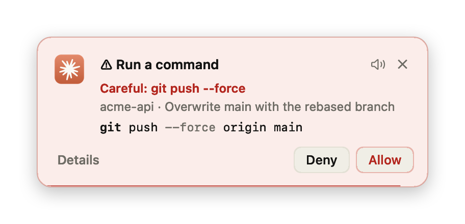
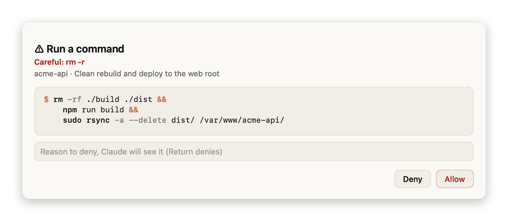

# Claude Code Permission Popup

[](https://github.com/c1dx1/claude-code-permission-popup/actions/workflows/ci.yml)

Answer Claude Code permission prompts from a small card in the corner of the screen, without switching back to Claude.
macOS only.

<p align="center">
  
</p>

When Claude Code wants to run a command or change a file, a card slides in at the corner of the screen. It shows what
Claude is asking for: the command, split one step per line, or the diff of an edit. Buttons: **Allow**, **Deny** and,
when Claude Code offers a rule for similar calls, **Always**.

## Features

- **Answer from anywhere.** The card floats above other apps but never takes keyboard focus. Global shortcuts answer
  the top card without the mouse.
- **Hard to approve by accident.** Buttons wake up only once the pointer has moved onto the card and 0.6 s have
  passed, so a click aimed at whatever was under the card can't land on **Allow**.
- **Dangerous requests stand out.** `rm -r`, `sudo`, force pushes, `git reset --hard`, `curl | sh`, `DROP TABLE`,
  `kubectl delete`, `terraform apply`, anything mentioning `prod`, and edits of `.env`, `.ssh` or `.git` turn the card
  red. For those, **Allow** is never the default: Return, the shortcut and temporary grants don't apply.
- **Readable requests.** Long command chains are split one step per line and highlighted. Session temp paths, the
  project directory and the home directory are shortened for display only; the details view shows the exact command
  in a tooltip. MCP and other tools show their arguments as `key: value` lines.
- **Details on demand.** Click the card or **Details** for the full command or diff. There you can also deny with a
  reason Claude will read, or allow similar calls for 10 minutes.
- **Gets out of the way.** A card times out after 15 seconds (paused while the pointer is over it) and hands the
  question to Claude Code's own prompt. It also steps aside as soon as you open that chat in the Claude desktop app,
  or once the request is settled some other way. There is no card at all for the chat you are already looking at.
  The project name on the card opens the chat.
- **Stacks.** Requests from parallel sessions stack oldest first; when one goes away, the rest move up. A menu bar
  badge counts what is waiting.
- **One-click mute.** The speaker icon on the card turns the sound off and back on; the choice is remembered.
  The menu bar badge has the same **Sound** switch.
- Follows light and dark mode. The UI is in English, or in Russian when that is the system language.

| Light | Dark |
| --- | --- |
|  |  |


### Dangerous requests

A risky request turns the card red and names what caught the eye. **Allow** stays clickable but is no longer the
default, so neither Return nor ⌃⌥Y can approve it by habit.

<p align="center">
  
</p>



## Install

You need macOS 13 or later and the `claude` command in Terminal (`claude --version` prints a version).
Plugins installed from Terminal work in the Claude desktop app too: both read `~/.claude`.

1. Add this repository as a plugin marketplace, the catalog Claude Code installs plugins from:

   ```bash
   claude plugin marketplace add c1dx1/claude-code-permission-popup
   ```

2. Install the plugin:

   ```bash
   claude plugin install permission-popup@claude-code-permission-popup
   ```

3. Restart Claude Code: start a new `claude` session, or quit and reopen the desktop app.

4. Check it: ask Claude to do something that needs your permission, then switch to another app.
   A card slides in at the top-right corner of the screen.

Inside a `claude` session the same steps work as `/plugin marketplace add …` and `/plugin install …`.

If you previously wired this hook into `~/.claude/settings.json` by hand, remove it, or every request shows two cards.

**Update:**

```bash
claude plugin marketplace update claude-code-permission-popup
claude plugin update permission-popup@claude-code-permission-popup
```

Then restart Claude Code.

**Uninstall:** `claude plugin uninstall permission-popup@claude-code-permission-popup`.

## Shortcuts

They answer the top card and work from any app.

| Shortcut | Action |
| --- | --- |
| ⌃⌥Y | Allow (not for dangerous requests) |
| ⌃⌥N | Deny |
| ⌃⌥D | Open the details |

In the details window, Return allows and Esc denies; with the reason field focused, Return denies with that reason.

## Configuration

Set these in the `env` block of `~/.claude/settings.json`, for example
`{ "env": { "PERMISSION_POPUP_TIMEOUT": "30" } }`.

| Variable | Default | Meaning |
| --- | --- | --- |
| `PERMISSION_POPUP_TIMEOUT` | `15` | Seconds a card waits before handing the question to Claude Code's prompt |
| `PERMISSION_POPUP_CORNER` | `top-right` | `top-right`, `top-left`, `bottom-right` or `bottom-left` |
| `PERMISSION_POPUP_SOUND` | `1` | `0` turns the sound off for good; otherwise the speaker icon on the card decides |
| `PERMISSION_POPUP_GRANT_MINUTES` | `10` | How long **Allow for N min** lasts |

## How it works

The plugin registers a [`PermissionRequest` hook](https://code.claude.com/docs/en/hooks). Claude Code runs it before
showing its own prompt and passes the tool call on stdin. The hook shows the card and prints the decision:

| Action | Hook output |
| --- | --- |
| Allow | `{"behavior": "allow"}` |
| Always | allow plus the rule Claude Code suggested, as `updatedPermissions` |
| Allow for N min | allow, and remember a grant for this project (see below) |
| Deny | deny with `interrupt: true`, which stops Claude like "No" in its own prompt |
| Deny with a reason | deny with the reason as the message, so Claude can adapt and go on |
| ✕, timeout, request settled elsewhere | nothing, so Claude Code falls back to its own prompt |

Questions from Claude (`AskUserQuestion`) and plan approval are left to Claude Code. On other platforms the hook exits
silently.

<details>
<summary>Temporary grants</summary>

**Allow for N min** stores a grant in `~/Library/Application Support/permission-popup/grants.json`, scoped to the
project directory. It covers calls matching the rule Claude Code suggested (for example `Bash(go test:*)`), or exactly
this call when there is no suggestion. While it lasts, matching calls are allowed without a card. A prefix rule never
covers a command with something chained after it (`&&`, `;`, `|`, `$(…)`), and dangerous requests always ask.

</details>

<details>
<summary>How a card knows it is no longer needed</summary>

While the hook runs, Claude Code holds back its own prompt, so the card steps aside when any of these holds:

- The Claude desktop app is frontmost and the request's chat is open in it. The hook compares
  `CLAUDE_CODE_HOST_SESSION_ID` with the pane state the app keeps in
  `~/Library/Application Support/Claude/claude_desktop_config.json`. This is undocumented app state: if it changes,
  the card simply keeps showing. Chats in pop-out windows aren't recorded there, so they still get a card.
- Claude Code dropped the hook: its parent process exited or the pipe it reads the answer from was closed.
- The tool result for this call is already in the session transcript.

</details>

## Development

```
plugins/permission-popup/
  Sources/Core.swift   parsing, diff, danger detection, rules and grants; no AppKit, covered by tests
  Sources/main.swift   the card, the details window, shortcuts and the hook protocol
  Tests/main.swift     tests for Core.swift
  make-icon.swift      draws the app icon
  build.sh             builds PermissionPopup.app for Apple Silicon and Intel, macOS 13+
  test.sh              runs the tests
  bin/permission-popup the hook entry point; exits silently off macOS and builds the app if it is missing
docs/screenshots/      demo requests and the script that renders the README images
```

- `plugins/permission-popup/test.sh` runs the tests; only the Xcode Command Line Tools are needed.
- `plugins/permission-popup/build.sh` rebuilds the app. Commit the result: the plugin ships it prebuilt.
- `docs/screenshots/make.sh` re-renders the README images from `docs/screenshots/requests/`.

CI runs the tests, checks that the committed app was built from the current sources, builds it from scratch and
validates the marketplace and plugin manifests.

The look can be checked without screen recording access:

```bash
PERMISSION_POPUP_SNAPSHOT=/tmp/shot PERMISSION_POPUP_APPEARANCE=dark \
  plugins/permission-popup/PermissionPopup.app/Contents/MacOS/permission-popup -AppleLanguages '(en)' < request.json
```

This writes `/tmp/shot-card.png` and `/tmp/shot-window.png`.
