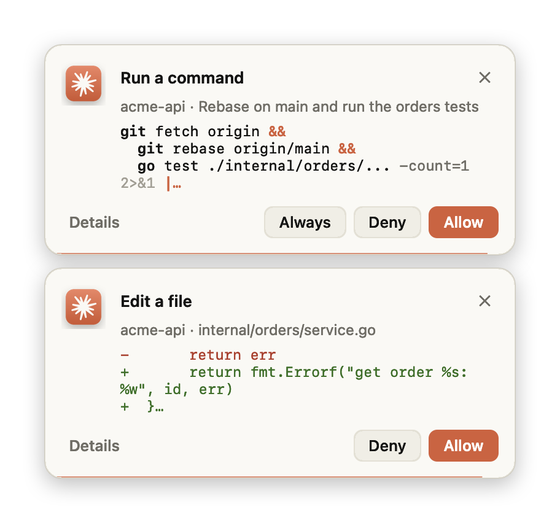
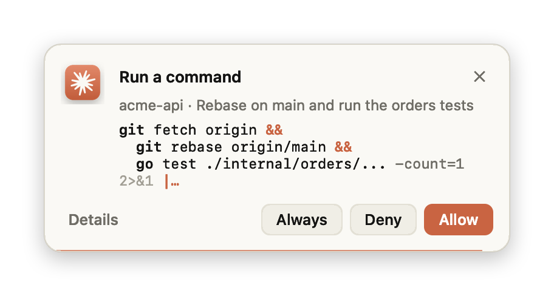
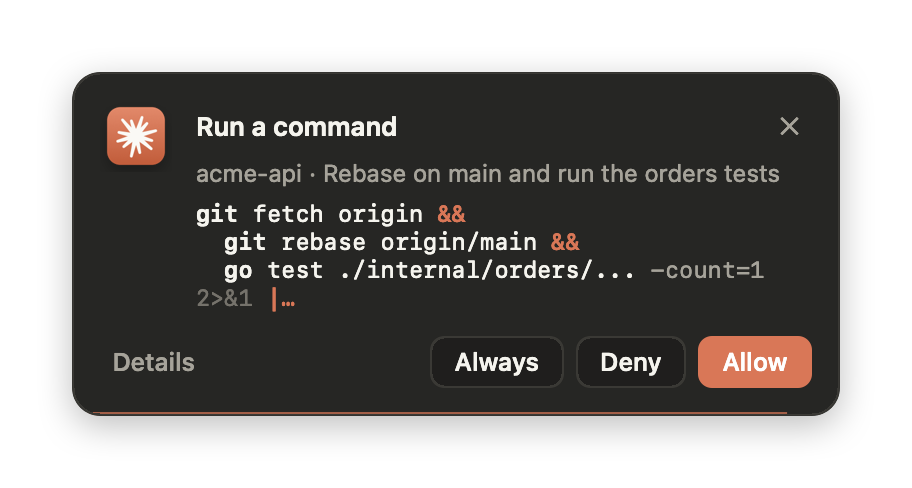
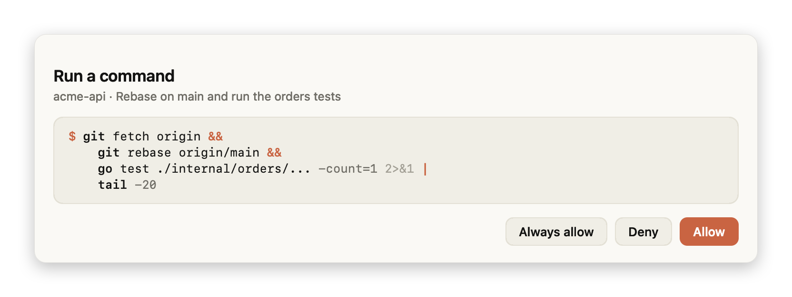
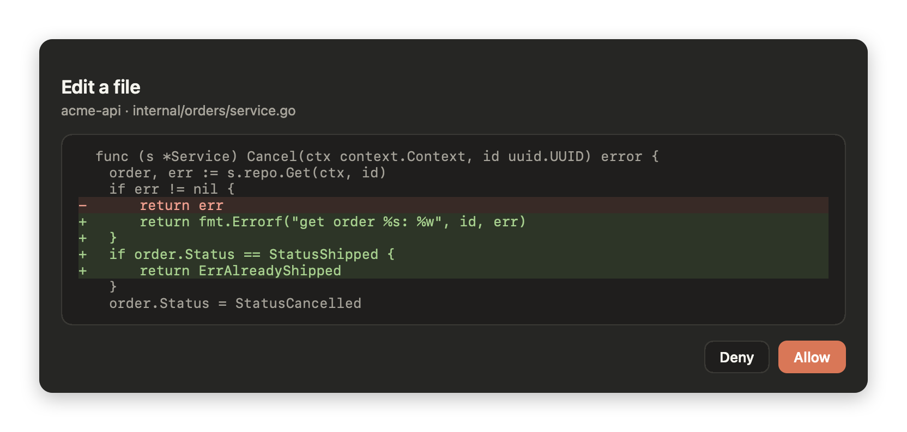

# Claude Code Permission Popup

Answer Claude Code permission prompts from a small card in the corner of the screen, without switching back to Claude.
macOS only.

<p align="center">
  
</p>

When Claude Code wants to run a command or change a file, a card slides in at the top-right corner. It shows what
Claude is asking for: the command, split one step per line, or the diff of an edit. Buttons: **Allow**, **Deny** and,
when Claude Code offers a rule for similar calls, **Always**.

## Features

- **Answer from anywhere.** The card floats above other apps but never takes keyboard focus, so a keystroke meant for
  another app can't approve anything.
- **Readable requests.** Long command chains are split one step per line and highlighted. Session temp paths, the
  project directory and the home directory are shortened for display only; the details view shows the exact command
  in a tooltip.
- **Details on demand.** Click the card or **Details** to see the full command or diff. Return allows, Esc denies.
- **Gets out of the way.** A card times out after 15 seconds (paused while the pointer is over it) and hands the
  question to Claude Code's own prompt. It also steps aside as soon as you open that chat in the Claude desktop app,
  or once the request is settled some other way. There is no card at all for the chat you are already looking at.
- **Stacks.** Requests from parallel sessions stack oldest on top; when one goes away, the rest move up.
- Follows light and dark mode. The UI is in English, or in Russian when that is the system language.

| Light | Dark |
| --- | --- |
|  |  |





## Install

You need macOS 13 or later and Claude Code (CLI or desktop app). The repository is private, so git must be able to
clone it, for example after `gh auth login`.

In Claude Code:

```
/plugin marketplace add c1dx1/claude-code-permission-popup
/plugin install permission-popup@claude-code-permission-popup
```

Or from a terminal:

```bash
claude plugin marketplace add c1dx1/claude-code-permission-popup
claude plugin install permission-popup@claude-code-permission-popup
```

To update later: `/plugin marketplace update claude-code-permission-popup`.

If you previously wired this hook into `~/.claude/settings.json` by hand, remove it, or every request shows two cards.

## Configuration

| Variable | Default | Meaning |
| --- | --- | --- |
| `PERMISSION_POPUP_TIMEOUT` | `15` | Seconds a card waits before handing the question to Claude Code's prompt |

Set it in `~/.claude/settings.json`:

```json
{ "env": { "PERMISSION_POPUP_TIMEOUT": "30" } }
```

## How it works

The plugin registers a [`PermissionRequest` hook](https://code.claude.com/docs/en/hooks). Claude Code runs it before
showing its own prompt and passes the tool call on stdin. The hook shows the card and prints the decision:

| Action | Hook output |
| --- | --- |
| Allow | `{"behavior": "allow"}` |
| Always | allow plus the rule Claude Code suggested, as `updatedPermissions` |
| Deny | deny with `interrupt: true`, which stops Claude like "No" in its own prompt |
| ✕, timeout, request settled elsewhere | nothing, so Claude Code falls back to its own prompt |

Questions from Claude (`AskUserQuestion`) and plan approval are left to Claude Code. On other platforms the hook exits
silently.

<details>
<summary>How a card knows it is no longer needed</summary>

While the hook runs, Claude Code holds back its own prompt, so the card steps aside when any of these holds:

- The Claude desktop app is frontmost and the request's chat is open in it. The hook compares
  `CLAUDE_CODE_HOST_SESSION_ID` with the pane state the app keeps in
  `~/Library/Application Support/Claude/claude_desktop_config.json`. This is undocumented app state: if it changes,
  the card simply keeps showing.
- Claude Code dropped the hook: its parent process exited or the pipe it reads the answer from was closed.
- The tool result for this call is already in the session transcript.

</details>

## Build

The plugin ships a prebuilt universal app (Apple Silicon and Intel). To rebuild it from source, run
`plugins/permission-popup/build.sh`; it needs the Xcode Command Line Tools. If the app is missing, the hook builds it
on first use.

The look can be checked without screen recording access:

```bash
PERMISSION_POPUP_SNAPSHOT=/tmp/shot PERMISSION_POPUP_APPEARANCE=dark \
  plugins/permission-popup/PermissionPopup.app/Contents/MacOS/permission-popup -AppleLanguages '(en)' < request.json
```

This writes `/tmp/shot-card.png` and `/tmp/shot-window.png`.

## Repository layout

- `.claude-plugin/marketplace.json`: a marketplace with this one plugin
- `plugins/permission-popup/`: the plugin itself, with the hook config, launcher, Swift sources and prebuilt app
- `docs/`: screenshots
